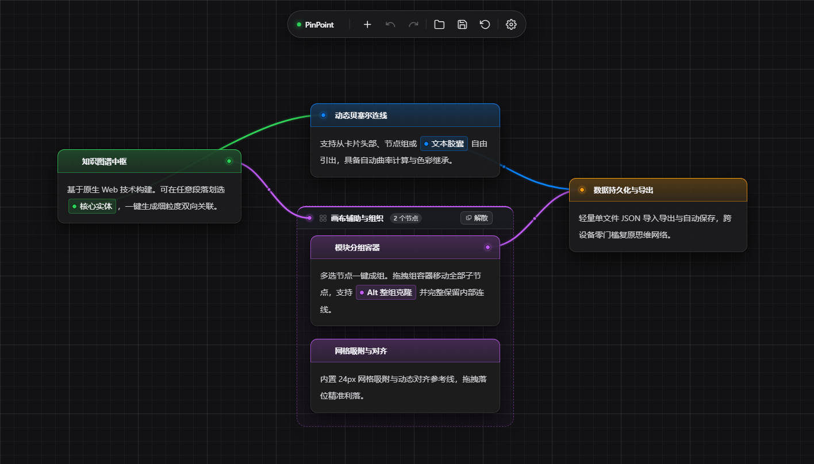

# PinPoint

> 极简、纯粹的无限画布思维图谱工具。



---

## 核心特性

- **自由连接**：划选卡片内任意文本即可转化为独立胶囊，支持自定义色彩，直接引出端点与其他节点或胶囊建立拓扑连接。
- **排版对齐**：内置 24px 网格吸附与多节点动态对齐参考线，提供多选对齐与等间距分布工具栏。
- **AI 协同**：提供 MCP 服务，允许与 AI 实时协同编辑画布，并同步当前选区与划选文本。
- **开箱即用**：前后端均无需安装第三方依赖，后端基于 Python 3.12 标准库，支持 `.pinpoint` 单文件导入导出与本地自动保存。

---

## 快速上手

```bash
# 仅使用纯前端静态画布
open index.html

# 启动完整服务，支持网页画布与 AI 实时协同
python server.py
# 启动后访问 http://localhost:5173
```

如需指定端口、加载特定 `.pinpoint` 文件或禁止自动打开浏览器，可附加参数：

```bash
python server.py --port 5173 --workspace path/to/file.pinpoint --no-browser
```

---

## Docker 部署

画布改动会自动保存到当前目录的 `data/workspace.pinpoint`：

```bash
# 构建并后台启动
docker compose up -d --build
# 启动后访问 http://localhost:5173

# 如需修改对外端口
PINPOINT_PORT=8080 docker compose up -d --build
```

---

## 接入 MCP

要让 AI 的操作实时呈现在浏览器画布上，请先保持本地或 Docker 中的 PinPoint 服务运行，再任选一种方式在客户端中配置。

### 方式一：Stdio 接入

适合 Claude、Cursor 等桌面客户端，推荐优先使用。请将路径替换为本项目所在的实际目录：

```json
{
  "mcpServers": {
    "pinpoint": {
      "command": "python",
      "args": ["/path/to/PinPoint/mcp_server.py"]
    }
  }
}
```

### 方式二：HTTP 接入

适合支持直接填写服务地址的客户端：

```json
{
  "mcpServers": {
    "pinpoint": {
      "type": "http",
      "url": "http://localhost:5173/mcp"
    }
  }
}
```

> 更多进阶启动参数、MCP 工具清单与 API 文档，请查阅 [docs/mcp.md](docs/mcp.md) 与 [docs/openapi.yaml](docs/openapi.yaml)。

---

## 常用快捷键

| 操作 | 快捷键 / 手势 |
| :--- | :--- |
| **画布缩放** | 滚轮 / 触摸板双指缩放 |
| **画布平移** | 空格 + 拖拽 / 鼠标中键拖拽 |
| **新建节点** | 双击画布空白处 / 顶部 HUD `+` 按钮 |
| **编辑节点标题** | 选中节点后按 `F2` / 双击标题 |
| **全选节点** | `Ctrl + A` |
| **框选多节点** | 画布空白处按住鼠标左键拉框 |
| **复制 / 粘贴 / 剪切** | `Ctrl + C` / `Ctrl + V` / `Ctrl + X`（内部连线完整保留） |
| **实时克隆** | 按住 `Alt` 拖动节点或组头部 |
| **撤销 / 重做** | `Ctrl + Z` / `Ctrl + Y` |
| **保存 / 打开** | `Ctrl + S` / 顶部 HUD 文件按钮 |
| **画板辅助设置** | 画布右键菜单（快速切换对齐/吸附） / `Ctrl + ,` 唤出设置面板 |
| **反转对齐吸附** | 拖动节点时按住 `Ctrl` 临时反转对齐吸附行为 |
